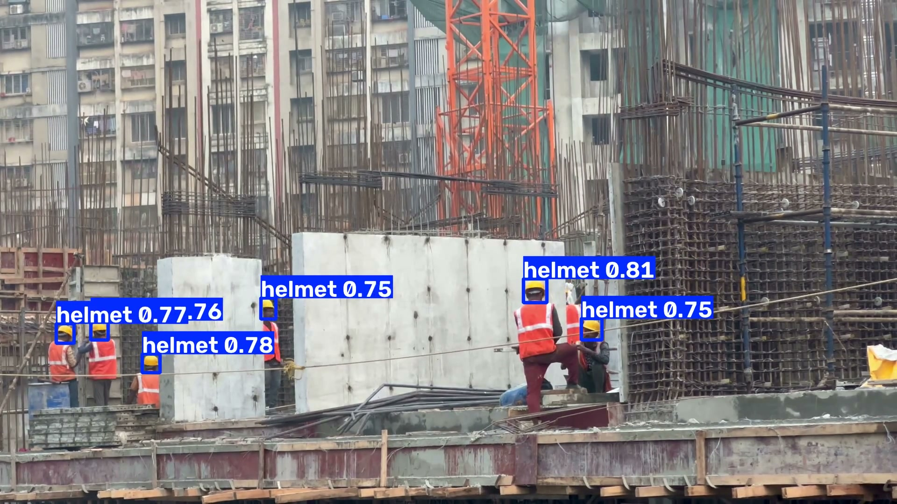

<h1 align="center">
  
</h1>

<p align="center">
  <a href="https://github.com/ttt-huong/helmet-detection-yolov8/actions/workflows/ci.yml"></a>
  <a href="https://www.python.org/"></a>
  <a href="https://pytorch.org/"></a>
</p>

<p align="center">
  <a href="https://colab.research.google.com/github/ttt-huong/helmet-detection-yolov8/blob/handoff-repro-checklist/notebooks/01_Chuan_bi_va_khao_sat_du_lieu.ipynb"></a>
  <a href="https://www.kaggle.com/code/maika123/notebookc7801aaccc/output?scriptVersionId=366157817"></a>
  <a href="https://drive.google.com/file/d/1Om8I1JsG1h8oeqn_iCFl5QcGQYJWE1D8/view"></a>
  <a href="https://docs.google.com/document/d/10zXsgy_0juhgdIpex2dbZ8Y8d3KVphTD/edit"></a>
</p>

<p align="center">
  Định vị vùng đầu trong ảnh và video công trường với hai nhãn <code>helmet</code> và <code>bare_head</code>.<br>
  So sánh YOLOv8n, YOLOv8s, YOLOv8m và YOLOv5su trên bộ dữ liệu SHWD.
</p>

<p align="center">
  <a href="#kết-quả">Kết quả</a> · <a href="#chạy-nhanh">Chạy nhanh</a> · <a href="#dữ-liệu-và-huấn-luyện">Dữ liệu</a> · <a href="#tái-lập-đánh-giá">Tái lập</a> · <a href="#phân-tích-lỗi">Phân tích lỗi</a>
</p>

## Demo video

[](https://drive.google.com/file/d/1Om8I1JsG1h8oeqn_iCFl5QcGQYJWE1D8/view)

Khung hình ở giây 18,67 cho thấy các hộp dự đoán `helmet` và điểm tin cậy. Video đầu ra dài khoảng **29 giây**, độ phân giải **1080p**. Bấm vào ảnh để mở video. [Chạy lại demo](#video) · [Nguồn clip: aksinfo7 universe trên Pexels](https://www.pexels.com/video/construction-workers-building-urban-skyscraper-29888510/)


## Kết quả

Kết quả chính trên `test_clean` (1.087 ảnh). YOLOv8m đạt mAP cao nhất, còn YOLOv8n có tốc độ xử lý ảnh cao nhất.

| Mô hình | Precision | Recall | mAP@0.5 | mAP@0.5:0.95 | FPS trên ảnh |
| --- | ---: | ---: | ---: | ---: | ---: |
| YOLOv8n | 92,40% | 86,81% | 93,25% | 63,14% | **107,24** |
| YOLOv8s | **92,62%** | 89,79% | 94,60% | 65,11% | 54,95 |
| YOLOv8m | 92,43% | **90,73%** | **95,07%** | **65,48%** | 22,24 |
| YOLOv5su | 92,40% | 89,68% | 94,68% | 64,78% | 62,44 |

Đo FPS trên cùng GPU Tesla T4, batch 1, 300 lượt mỗi mô hình sau khi làm nóng, với ảnh đã giải mã. Demo video YOLOv8m đạt **16,79 FPS** khi tính cả đọc, thu nhỏ, suy luận, vẽ khung, ghi video trung gian và lưu ảnh mẫu. Mã hóa H.264 được thực hiện sau phép đo.

[Bảng kết quả cả ba tập](results/helmet_test_summary.csv) · [Bảng đo tốc độ](results/helmet_speed_summary.csv) · [Cấu hình huấn luyện](configs/experiment_config.json)

## Chạy nhanh

Cần Python 3.12 trở lên và bản PyTorch phù hợp với máy. Các lệnh dưới đây chạy từ thư mục repo.

```sh
git clone --branch handoff-repro-checklist https://github.com/ttt-huong/helmet-detection-yolov8.git
cd helmet-detection-yolov8
python -m pip install -r requirements.txt
```

Lấy checkpoint YOLOv8m đã huấn luyện, đặt tại `weights/v8m/best.pt`. Các tài liệu và checkpoint trên Drive hoặc Kaggle có thể cần quyền truy cập. [Thư mục checkpoint](https://drive.google.com/drive/folders/16BKDss7JgPP565ayg1fow6ZEUUdVbbzh)

### Video

Để tái tạo ví dụ trên, cần hai tệp đầu vào: clip gốc `12831498_3840_2160_30fps.mp4` (4K, 30 FPS, 874 khung hình) và checkpoint YOLOv8m đặt tại `weights/v8m/best.pt`. Cài FFmpeg có `libx264` và thêm vào PATH. Dùng một đường dẫn đầu ra mới cho mỗi lần chạy. [Tải clip gốc từ Pexels](https://www.pexels.com/video/construction-workers-building-urban-skyscraper-29888510/) · [Thư mục checkpoint](https://drive.google.com/drive/folders/16BKDss7JgPP565ayg1fow6ZEUUdVbbzh)

```sh
python scripts/demo_video.py --source /path/to/12831498_3840_2160_30fps.mp4 --weights weights/v8m/best.pt --output runs/demo
```

Sau khi chạy trên CPU, mở `runs/demo/demo_v8m_clip2.mp4` để xem video có khung dự đoán. Tệp `runs/demo/demo_log.txt` ghi cấu hình, số khung hình, SHA-256 của checkpoint và thời gian xử lý. [Xem đầu ra mẫu](https://drive.google.com/file/d/1Om8I1JsG1h8oeqn_iCFl5QcGQYJWE1D8/view)

### Webcam

Cài `mediapipe==1.2.2`. Tải `blaze_face_short_range.tflite` và `hand_landmarker.task` vào `models/`. Chạy trên máy có webcam và OpenCV hỗ trợ cửa sổ. Bấm `Q` hoặc `Esc` để thoát. [MediaPipe Face Detector](https://developers.google.com/edge/mediapipe/solutions/vision/face_detector#models) · [MediaPipe Hand Landmarker](https://developers.google.com/edge/mediapipe/solutions/vision/hand_landmarker#models)

```sh
python scripts/demo_webcam.py --weights weights/v8m/best.pt --models-dir models --camera 0
```

## Dữ liệu và huấn luyện

Tải tệp `VOC2028.zip` gốc. Script kiểm tra SHA-256 của tệp ZIP và danh sách chia tập trước khi dựng **7.581 ảnh, 120.561 hộp nhãn và 7 danh sách chia tập**. Chọn thư mục đầu ra mới. [Kho dữ liệu SHWD](https://github.com/njvisionpower/Safety-Helmet-Wearing-Dataset) · [Tệp ZIP gốc](https://drive.google.com/file/d/1qWm7rrwvjAWs1slymbrLaCf7Q-wnGLEX/view) · [Quy tắc nhãn](configs/label_rules.md)

```sh
python scripts/prepare_shwd.py --archive /path/to/VOC2028.zip --manifests manifests --output data/processed/helmet_yolo
```

| Tập | Ảnh | Vai trò |
| --- | ---: | --- |
| `val_clean` | 425 | Chọn checkpoint và ngưỡng cho phân tích lỗi |
| `test_clean` | 1.087 | Báo cáo kết quả chính sau khi lọc ảnh nghi trùng |
| `test` | 1.517 | Bộ chia gốc của SHWD, dùng tham chiếu |
| `test_clean_site` | 628 | Tập con theo nhóm nguồn `numeric` và `part2` |

Cả bốn mô hình hoàn thành 30 epoch với ảnh 640 px, batch 16 và seed 42. Notebook Colab gồm 17 ô chuẩn bị và chạy thử, sau đó là 8 ô khôi phục, huấn luyện và kiểm tra. Các ô huấn luyện dùng tên run định sẵn trên Drive, nên kiểm tra thư mục đích trước khi chạy. [Notebook Colab](notebooks/01_Chuan_bi_va_khao_sat_du_lieu.ipynb)

<details>
<summary>Tiếp tục lần huấn luyện YOLOv5su bị gián đoạn</summary>

Dùng môi trường CUDA. Đặt `boxes_raw.csv` từ notebook Colab và bảy tệp trong `manifests/` vào `audit/`. Đặt `results.csv`, `weights/last.pt` có trạng thái optimizer, `weights/best.pt` và `args.yaml` nếu có vào `source_run/`. Các thư mục đầu ra phải là đường dẫn mới. [Đầu ra lần tiếp tục trên Kaggle](https://www.kaggle.com/code/maika123/notebook7514cf8358/output?scriptVersionId=366138307)

```sh
python scripts/continue_v5su.py --audit-dir audit audit
python scripts/continue_v5su.py --audit-dir audit prepare /path/to/VOC2028.zip data/processed/helmet_yolo_resume
python scripts/continue_v5su.py --audit-dir audit resume data/processed/helmet_yolo_resume source_run runs/v5su_resumed
```

</details>

## Tái lập đánh giá

Đặt bốn checkpoint tin cậy tại `weights/v8n/best.pt`, `weights/v8s/best.pt`, `weights/v8m/best.pt` và `weights/v5su/best.pt`. Chọn thư mục đầu ra mới cho mỗi lần chạy.

### Kiểm tra bằng CPU

Kiểm tra SHA-256 của checkpoint, suy luận và chấm trên 24 ảnh cố định. Đọc kết quả tại `runs/smoke/smoke_summary.json`.

```sh
python scripts/smoke_repro.py --data-root data/processed/helmet_yolo --manifests manifests --weights weights --output runs/smoke
```

### Đánh giá đầy đủ bằng GPU

Dùng PyTorch có CUDA. Lệnh đánh giá bốn mô hình trên ba tập và lưu bảng kết quả, bảng đo tốc độ, dự đoán và biểu đồ.

```sh
python scripts/evaluate_helmet.py --data-root data/processed/helmet_yolo --manifests manifests --v8n weights/v8n/best.pt --v8s weights/v8s/best.pt --v8m weights/v8m/best.pt --v5su weights/v5su/best.pt --output runs/evaluation
```

Phiên tái lập T78 trên Tesla T4 cho cùng Precision, Recall và hai chỉ số mAP ở cả 12 lượt đánh giá. Notebook cần Internet và quyền gắn các đầu vào Kaggle có `v8n_best.pt`, `v8s_best.pt`, `v8m_best.pt` và `kaggle_resume_metadata.json` nằm cạnh `weights/best.pt` của YOLOv5su. [Notebook T78](notebooks/02_Tai_lap_danh_gia_T78.ipynb) · [Đầu ra tái lập](https://www.kaggle.com/code/maika123/fork-of-notebookc7801aaccc/output?scriptVersionId=368715960)

## Phân tích lỗi

Ở ngưỡng confidence 0,408 và IoU ghép hộp 0,50, Recall của lớp `helmet` là **42,00% (63/150)** với hộp có cạnh dài dưới 16 px sau khi quy cạnh dài ảnh về 640 px. Các hộp còn lại đạt **94,54% (1.507/1.594)**. [Bảng phân tích theo nhóm](results/strata_v8m_test_clean.csv) · [Danh mục 10 ca lỗi](results/error_case_index.csv)

<details>
<summary>Chạy lại phân tích và xuất ảnh minh họa</summary>

Đặt `boxes_raw.csv` và bản sao `manifests/test_clean.txt` vào `audit/`. Thư mục dự đoán `labels/` và tệp `metrics.json` được tạo ở cùng cấp bởi lệnh đánh giá YOLOv8m trên `test_clean`.

```sh
python scripts/analyze_saved_v8m.py --audit audit --labels runs/evaluation/evaluation/v8m/test_clean/labels --images /path/to/VOC2028.zip --out runs/errors
python scripts/plot_v8m_error_cases.py --analysis runs/errors --images /path/to/VOC2028.zip --out runs/error_examples.png
python scripts/analyze_image_conditions.py prepare --data-root data/processed/helmet_yolo --manifests manifests --matches runs/errors/ground_truth_matches.csv --output runs/conditions
python scripts/plot_occlusion_review.py --sample runs/conditions/occlusion_sample.csv --images data/processed/helmet_yolo/images --output runs/occlusion_review
```

Điền các cột `review_id,occlusion,note` trong `occlusion_blind.csv` sau khi rà ảnh gốc. Giá trị `occlusion` là `che`, `khong_che` hoặc `khong_ro`. Có thể dùng lại tệp nhãn đã lưu để đối chiếu kết quả. [Hồ sơ T52–T53](https://drive.google.com/file/d/1dQm7E3KNks1RJNK68uf3R-pL3cl-Mq87/view)

```sh
python scripts/analyze_image_conditions.py aggregate --conditions runs/conditions --review occlusion_blind.csv --matches runs/errors/ground_truth_matches.csv --output runs/conditions_summary
```

</details>

Phân tích che khuất mô tả mẫu 48 hộp, trong đó 15 hộp chưa đủ rõ để gán nhãn. Chỉ số độ sáng và độ nét được tính trên toàn ảnh. Nguồn công trường của từng ảnh trong `test_clean_site` chưa được xác minh. Mỗi mô hình được huấn luyện với một seed, và video demo chưa có nhãn chuẩn theo từng khung hình. [Giới hạn dữ liệu](configs/dataset_limitations.md)

## Cấu trúc repo

| Thư mục | Nội dung |
| --- | --- |
| [`notebooks/`](notebooks/) | Chuẩn bị, huấn luyện trên Colab và tái lập trên Kaggle |
| [`scripts/`](scripts/) | Dựng dữ liệu, đánh giá, phân tích lỗi và demo |
| [`configs/`](configs/) | Cấu hình thí nghiệm và quy tắc nhãn |
| [`manifests/`](manifests/) | Danh sách ảnh cố định của từng tập |
| [`results/`](results/) | Bảng kết quả và chỉ mục ca lỗi |
| [`docs/`](docs/) | [Checklist 13 nhóm kiểm thử](docs/checklist_kiem_thu.md) |

## Nguồn

- Bộ dữ liệu và tài liệu mô hình. [SHWD](https://github.com/njvisionpower/Safety-Helmet-Wearing-Dataset) · [Ultralytics YOLOv8](https://docs.ultralytics.com/models/yolov8/) · [Ultralytics YOLOv5u](https://docs.ultralytics.com/models/yolov5/)
- Phép ghép hộp trong `analyze_saved_v8m.py` dựa trên mã phân tích của Tuấn. [Mã phân tích gốc](https://github.com/mahTuqn/Noron/blob/main/scripts/analyze_errors.py)
- Tham khảo bố cục README. [Ultralytics YOLOv5](https://github.com/ultralytics/yolov5) · [Roboflow Supervision](https://github.com/roboflow/supervision) · [Detectron2](https://github.com/facebookresearch/detectron2) · [MMDetection](https://github.com/open-mmlab/mmdetection)
